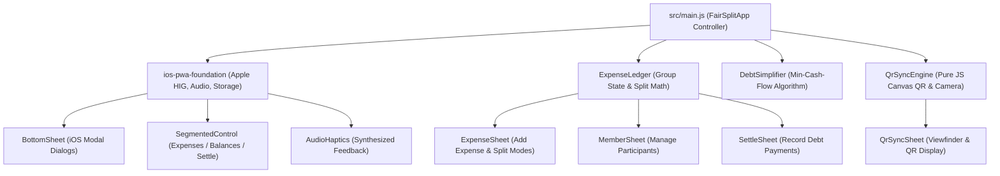

# FairSplit

A premium, private, zero-backend P2P expense splitter and debt minimizer built from scratch as a personal hobby project using pure HTML5, modern CSS3, modular ES6 JavaScript, procedural Web Audio haptics, and the shared Apple HIG design system ([`ios-pwa-foundation`](https://github.com/Zoro8048/ios-pwa-foundation)).

Designed as an offline-first, completely private alternative to bloated, paywalled expense splitting apps. FairSplit requires no account creation, no cloud servers, and no tracking—syncing ledgers peer-to-peer using high-density QR codes and camera scanning.

---

## Table of Contents

1. [Quick Start (Local Development)](#quick-start-local-development)
2. [Running Automated Unit Tests](#running-automated-unit-tests)
3. [How the Architecture Works](#how-the-architecture-works)
4. [Core Features & Algorithms](#core-features--algorithms)
5. [Legal, IP & Non-Commercial Status](#legal-ip--non-commercial-status)

---

## Quick Start (Local Development)

The modular source code under `src/` is bundled into `app.js` via a zero-dependency bundler (`scripts/bundle.js`) so it works both by opening `index.html` directly (via `file://`) or over any local HTTP server:

```bash
# 1. Install dependencies (ios-pwa-foundation)
npm install

# 2. Bundle src/ -> app.js and run unit tests
npm test

# 3. Start local development server on port 8080
npm start
```

Then open `http://localhost:8080` in your desktop browser or mobile Safari/Chrome.

---

## Running Automated Unit Tests

The test suite runs on Node's native test runner (`node:test` and `node:assert`) with zero external testing dependencies:

```bash
npm test
# or directly:
node --test tests/*.test.js
```

---

## How the Architecture Works

### 1. High-Level Event & Data Flow



### 2. File Organization

```
fairsplit/
├── .github/workflows/deploy.yml   # GitHub Actions automated test & Pages deployment
├── index.html                     # Semantic HTML5 shell with notch & safe-area containers
├── style.css                      # Apple iOS HIG design tokens, dark canvas, and haptic CSS
├── app.js                         # Concatenated, standalone production runtime bundle
├── manifest.webmanifest           # Standalone PWA manifest
├── sw.js                          # Service Worker for 100% offline access
├── icon.svg                       # Vector app icon (procedural balance motif)
├── icon-192.png / icon-512.png    # PWA launcher icons
├── package.json                   # Dependencies and scripts
├── scripts/
│   └── bundle.js                  # Topological IIFE bundler with fallback resolver
├── src/
│   ├── main.js                    # FairSplitApp entry controller and event routing
│   ├── domain/
│   │   ├── DebtSimplifier.js      # Greedy Min-Cash-Flow debt graph optimization
│   │   ├── ExpenseLedger.js       # Multi-group state, currency, and split modes
│   │   └── QrSyncEngine.js        # Canvas QR code generator and P2P payload decoder
│   └── ui/
│       ├── ExpenseSheet.js        # Bottom sheet for logging purchases
│       ├── MemberSheet.js         # Bottom sheet for group member management
│       ├── SettleSheet.js         # Bottom sheet for recording cash/digital repayments
│       ├── QrSyncSheet.js         # Viewfinder camera scanner & QR code screen
│       └── GroupPickerSheet.js    # Group switcher and currency preferences
└── tests/
    ├── debt.test.js               # Min-cash-flow algorithm tests (chain reduction, cycles)
    ├── ledger.test.js             # Split math (Equal, Exact, Percent, Shares) & members
    └── qrsync.test.js             # Serialization and deserialization test suite
```

---

## Core Features & Algorithms

### 1. Greedy Min-Cash-Flow Debt Simplification
When groups travel or share housing, multiple overlapping debts create confusion (e.g. Alice pays for Bob, Bob pays for Charlie, Charlie pays for Alice).
`DebtSimplifier` computes individual net balances across all transactions:
$$\text{Net Balance}_i = \sum \text{Paid By}_i - \sum \text{Owed By}_i + \sum \text{Settled To}_i - \sum \text{Settled From}_i$$

It then runs a greedy max-creditor / max-debtor matching algorithm:
1. Identifies the member with the greatest net debt and the member with the greatest credit.
2. Settles the minimum of the two amounts between them directly.
3. Decrements balances and repeats until all balances reach zero.
*Result:* Reduces $O(N^2)$ cyclic debts to at most $N - 1$ minimal cash transfers.

### 2. Zero-Backend Peer-to-Peer QR Sync
FairSplit contains no cloud databases or remote servers. To sync an entire trip or household ledger to a friend's phone:
1. Tap **🔄 QR Sync**.
2. FairSplit generates an offline Version 4 QR matrix rendered directly to an HTML5 canvas via `QrSyncEngine`.
3. Your friend taps **Scan Friend's QR** using the iOS/Android camera viewfinder (`CameraService`), instantly importing all members, purchases, and payments.
4. Alternatively, use **Copy Sync Text** to share via AirDrop, iMessage, or Signal.

### 3. Apple HIG Native Feel
- **Dynamic Viewport Heights:** Uses `100dvh` and CSS `env(safe-area-inset-top)` / `env(safe-area-inset-bottom)` for seamless edge-to-edge rendering around the iPhone notch, Dynamic Island, and Home Indicator bar.
- **Haptic Audio Feedback:** Procedural Web Audio API ticks, taps, success fanfares, and warning alerts without loading audio asset files.
- **Interactive Bottom Sheets:** Smooth sliding sheets with swipe-to-dismiss handle gestures.

### 4. 4 Flexible Split Modes
- **Equally:** Splits expenses evenly with penny balancing to guarantee the sum of parts matches the receipt total down to the cent.
- **Exact ($):** Enter custom dollar amounts per person.
- **Percent (%):** Split by custom percentages.
- **Shares (x):** Split by weights or units (e.g. 2 shares for couples, 1 share for singles).

---

## Legal, IP & Non-Commercial Status

- **Personal Hobby Status:** This application is developed strictly as a personal, non-commercial educational project for managing household and personal group expenses.
- **Zero Monetization:** FairSplit contains no advertisements, paywalls, in-app purchases, paid tiers, subscriptions, referral commissions, or donation links.
- **Zero Telemetry & 100% Client-Side Privacy:** All ledger calculations and storage remain strictly inside the user's browser `localStorage`. No analytics, tracking pixels, or remote telemetry services are used.
- **Intellectual Property Separation:** Built on personal hardware and personal network connections without using any employer resources or confidential assets.

---

## License

MIT © Keerthan
